# GBOS: Googlebook OS on Waydroid

Run the Android 17 "Googlebook" system image from a Lenovo Googlebook 15 recovery image inside
[Waydroid](https://waydro.id) on an ordinary Linux PC, and link it to your Android phone with Phone Hub.

* **Android apps on your Linux desktop.** Use the full Googlebook desktop in one window, or switch on multi-window mode
  and GBOS apps appear in your app drawer and open in their own windows next to your Linux apps.
* **Your phone on your PC.** Phone Hub links GBOS to your Android phone: notifications, Do Not Disturb, phone files, and
  **App Cast**, which streams phone apps into a window you control with your mouse and keyboard, with the sound on your
  PC. **Continue On** picks up the app you have open on the phone.
* **Phone Hub in the GNOME top bar.** An optional GNOME Shell extension shows the link and opens any phone app in App
  Cast.

**Unofficial and experimental.** This is a hobby bring-up, developed and tested on one laptop and one phone. It is not
affiliated with or endorsed by Google, Lenovo or the Waydroid project. "Googlebook", "Android", "Pixel" and
"Chromium" belong to their owners.

<picture>
  <source media="(prefers-color-scheme: dark)" srcset="assets/screenshots/01-check-dark.png">
  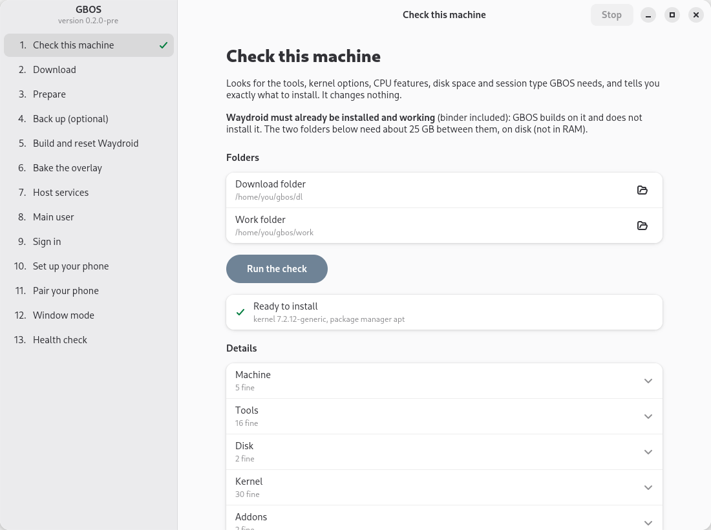
</picture>

## Before you start

* **Waydroid must already work on your machine**, binder included. GBOS replaces the Android image inside Waydroid; it
  does not install Waydroid. Get stock Waydroid booting first.
* **A recent CPU** (it has run on a 13th-gen Intel; an 8th-gen failed). The installer's first page tells you.
* **About 25 GB of free disk**, on a real disk (not `/tmp` where that is RAM).
* **Step 5 resets Waydroid.** Accounts and apps in your current Waydroid are removed (your old Android data is moved
  aside, not deleted). Step 4 backs it all up first.

The rest of the fine print is under [Read before installing](#read-before-installing).

## Install with the installer

Get the code and the installer's two libraries (GTK 4 and libadwaita; Debian 13, Ubuntu 24.04 and newer have recent
enough versions), then start it as your normal user:

```sh
git clone https://github.com/thewraith420/gbos-waydroid.git && cd gbos-waydroid
sudo apt install python3-gi gir1.2-gtk-4.0 gir1.2-adw-1     # Fedora: python3-gobject gtk4 libadwaita
installer/gbos-installer-gui.py
```

Work down the sidebar. Each page explains its step and has one button. Every command the installer runs is printed in
the page's **Output** pane first, so nothing happens out of sight. Steps that need root ask for your password in the
normal system dialog. Close it whenever you like: it remembers where you were.

### 1. Check this machine

Pick a download folder and a work folder, then **Run the check**. It looks at your CPU, kernel, tools, disk and session
and changes nothing. If packages are missing it shows one command for all of them: **Install** runs it (or **Copy** it to
run yourself), then the check runs again. Carry on when it says **Ready to install**.

<picture>
  <source media="(prefers-color-scheme: dark)" srcset="assets/screenshots/01-check-missing-dark.png">
  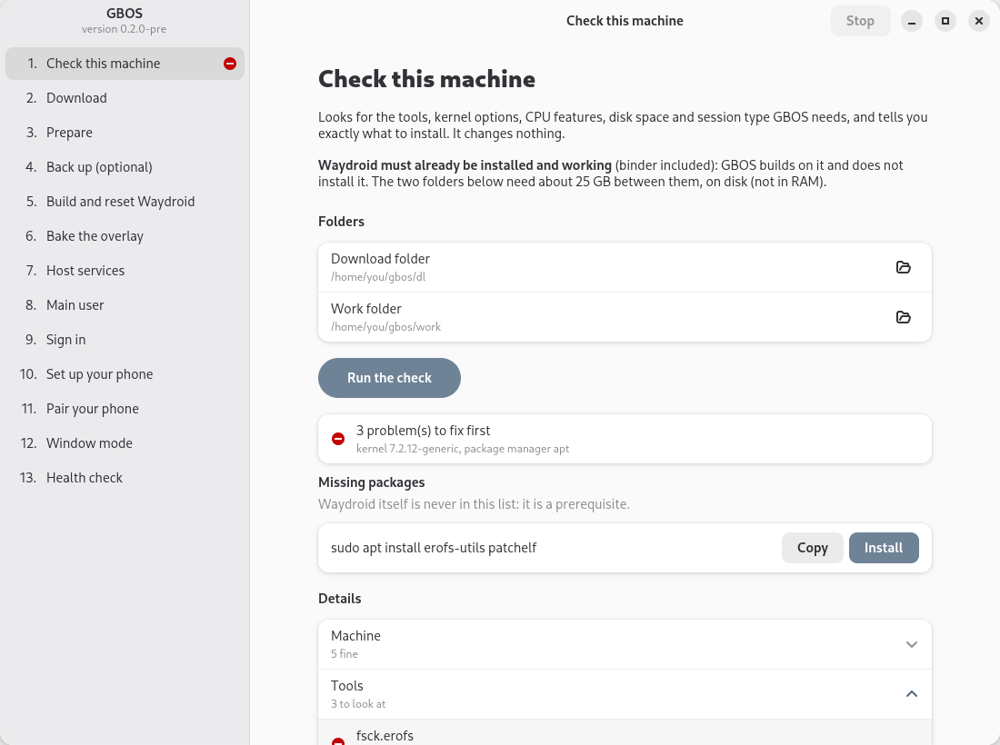
</picture>

If the check says a **kernel add-on** is needed (an older CPU, or some custom kernels), the same page builds and installs it,
and installs your kernel's headers first if they are missing:
[INSTALL.md, kernel add-ons](docs/INSTALL.md#kernel-add-ons-only-if-check-says-needed-here).

### 2. Download

About 10 GB from the original publishers (Google's recovery image, the Waydroid Android 16 images, an upstream WebView,
the Android build tools). Every file is checked against its published checksum. You can stop and start again: it
resumes. Leave the **prebuilt** option on unless you want to build the four small Android programs yourself.

<picture>
  <source media="(prefers-color-scheme: dark)" srcset="assets/screenshots/02-download-dark.png">
  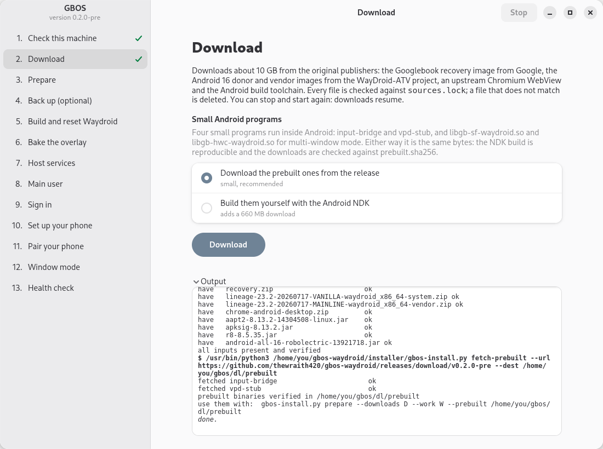
</picture>

### 3. Prepare

Unpacks the Googlebook image, patches what needs patching and builds the small apps, all inside the work folder
(about a minute). Leave **Phone Hub** on if you want to link a phone.

<picture>
  <source media="(prefers-color-scheme: dark)" srcset="assets/screenshots/03-prepare-dark.png">
  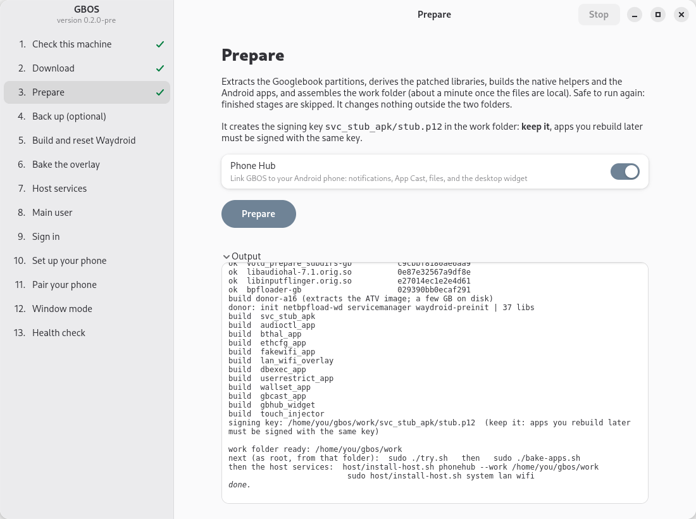
</picture>

### 4. Back up (optional)

If your current Waydroid holds anything you want to keep, **Back up** saves it and checks the copy. Nothing to keep?
**Nothing to keep: skip**.

<picture>
  <source media="(prefers-color-scheme: dark)" srcset="assets/screenshots/04-backup-dark.png">
  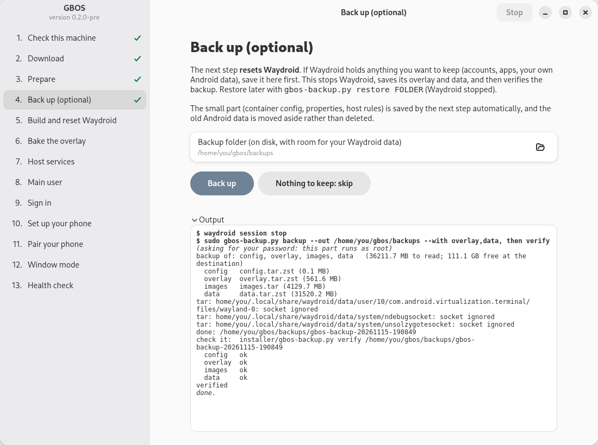
</picture>

### 5. Build and reset Waydroid

The big one, and the only destructive step. It builds the GBOS system image, resets Waydroid onto it, and starts
Android for the first time (a few minutes). It asks you to type **reset** before it does anything.

<picture>
  <source media="(prefers-color-scheme: dark)" srcset="assets/screenshots/05-build-confirm-dark.png">
  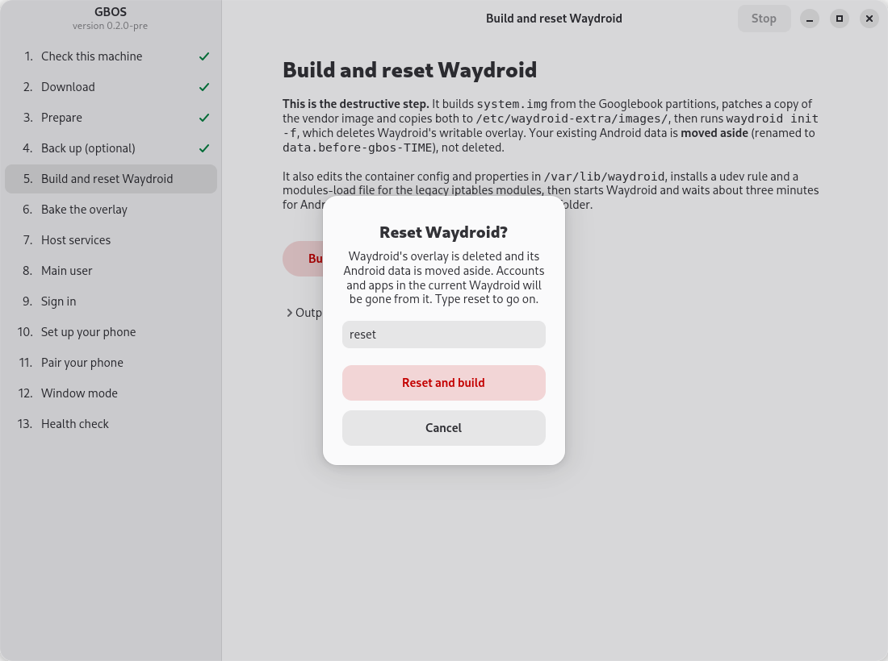
</picture>

### 6. Bake the overlay

Installs everything that makes GBOS work on top of the image: the WebView, services, boot scripts, apps and the Phone
Hub widget. It never touches your data, and it is also how updates are applied later. **The first boot afterwards is
slow**; give it several minutes.

<picture>
  <source media="(prefers-color-scheme: dark)" srcset="assets/screenshots/06-bake-dark.png">
  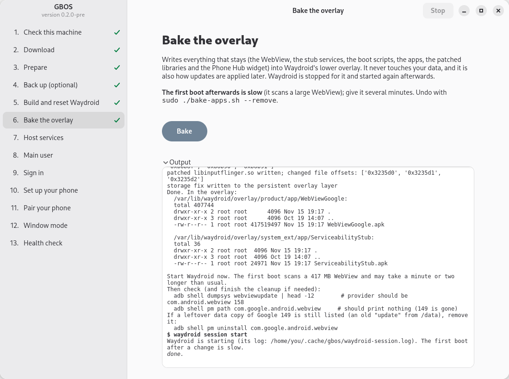
</picture>

### 7. Host services

Gives Android Wi-Fi and a presence on your network (Phone Hub needs both) and, with Phone Hub on, installs its services
on your PC. Switch on **Share the Bluetooth adapter** if you want Android to use your PC's Bluetooth. On GNOME, leave
**Phone Hub in the GNOME top bar** on to install the extension (on Wayland it appears after you log out and back in).

<picture>
  <source media="(prefers-color-scheme: dark)" srcset="assets/screenshots/07-host-dark.png">
  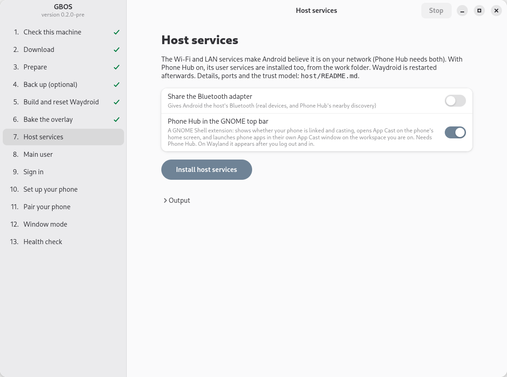
</picture>

### 8. Main user

Once GBOS has reached its desktop for the first time, **Set the main user** (Google services expect it). GBOS restarts
and shows a user picker with one user, **Owner**: click it.

<picture>
  <source media="(prefers-color-scheme: dark)" srcset="assets/screenshots/08-mainuser-dark.png">
  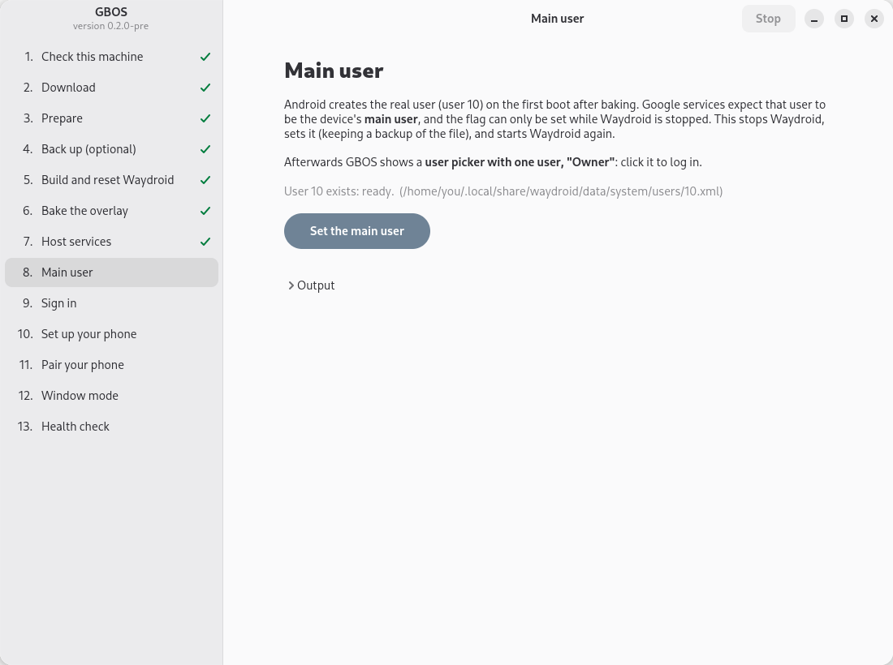
</picture>

### 9. Sign in

In GBOS, sign in with the Google account **you use on your phone**, from the **Finish Googlebook setup** notification
(or Settings, Add account). Sign-in pages are slow; give each up to a minute. Then **Apply Phone Hub settings**.

<picture>
  <source media="(prefers-color-scheme: dark)" srcset="assets/screenshots/09-signin-dark.png">
  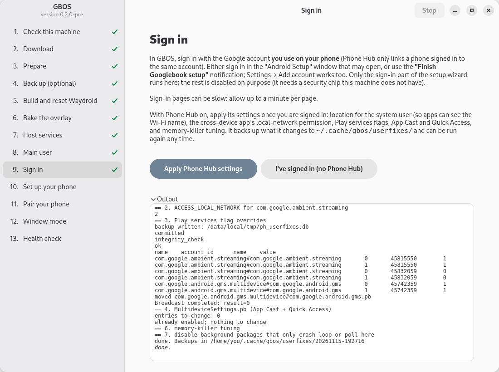
</picture>

### 10. Set up your phone

On your Android phone (Android 14 or newer) turn on **Wireless debugging** in Developer options and copy its address and
port into the page; the first time, also the pairing address and code from *Pair device with pairing code*. **Set up
phone** installs the companion app GBOS Cast, grants the permissions it needs, allows its notification access, and
checks that each change took. Picture, sound and touch all go through GBOS Cast's agent, so there is no screen-recording
prompt and no red recording pill on the phone. Leave the accessibility switch off unless the agent cannot start on your
phone.

<picture>
  <source media="(prefers-color-scheme: dark)" srcset="assets/screenshots/10-phonesetup-dark.png">
  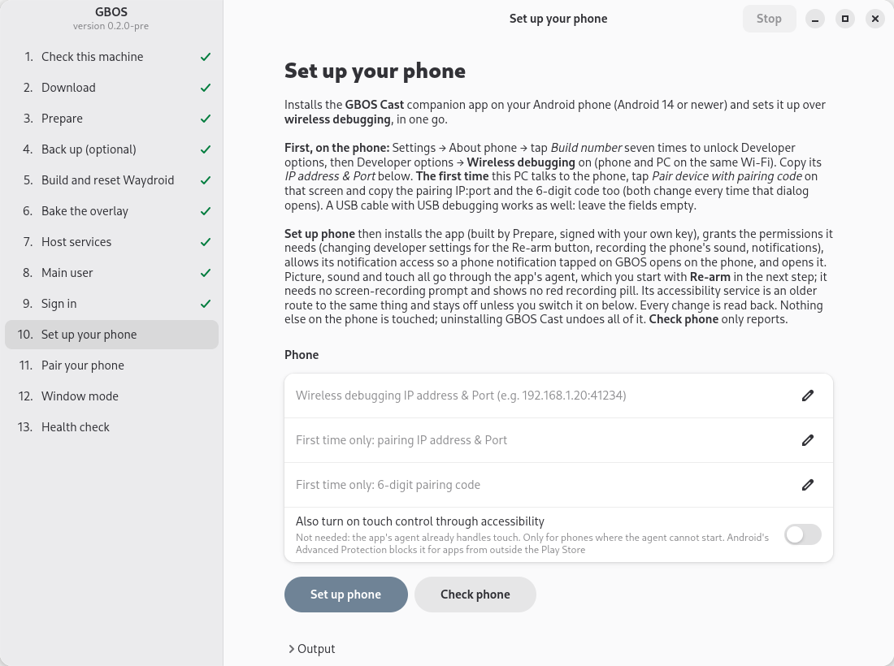
</picture>

### 11. Pair your phone

In GBOS Cast press **Re-arm touch forwarding** once, turn on Cross-device services on the phone, and scan the QR code
GBOS shows. The page lists each step. Then start casting from GBOS Cast or its **Quick Settings tile** (long-press the
tile to open the app), and open a phone app from App Cast in GBOS or from the GNOME top bar. The phone's sound plays on
the PC while an App Cast window is open, and on the phone when none is. Put the **Phone Hub widget** on the GBOS desktop
to see the link and reconnect it in one click.

<picture>
  <source media="(prefers-color-scheme: dark)" srcset="assets/screenshots/11-phone-dark.png">
  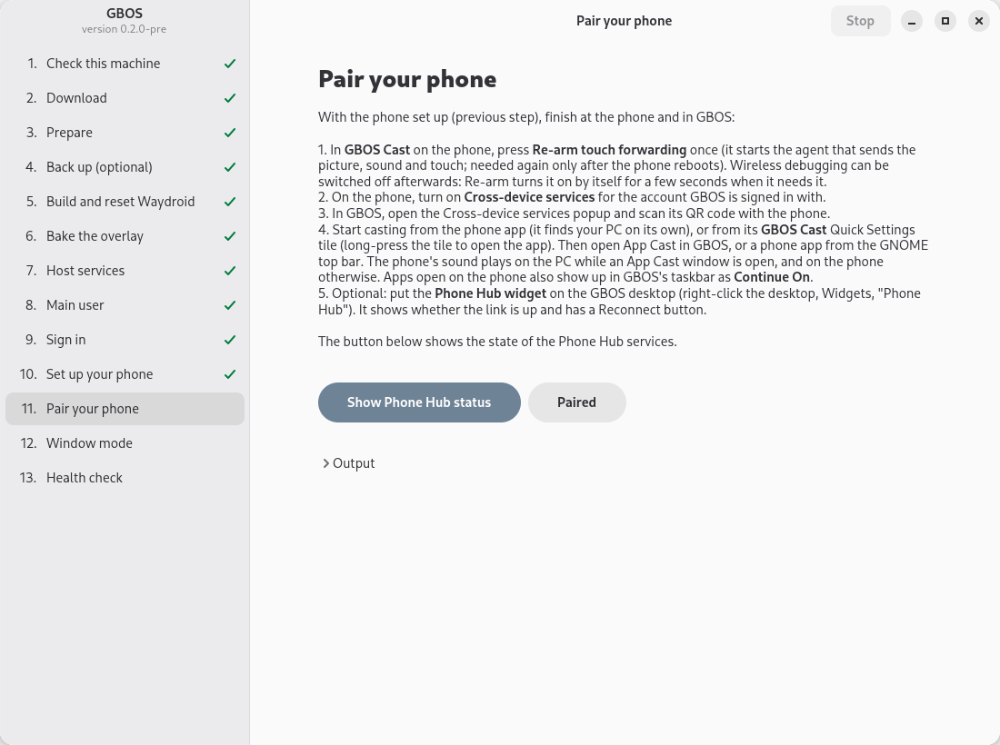
</picture>

### 12. Window mode

Choose how GBOS shows up on your desktop. **Single-window** (the default) keeps the whole Googlebook desktop in one
window. **Multi-window** puts GBOS apps in your Linux app drawer, each opening in its own window; you can still open the
full desktop any time (`waydroid show-full-ui`). Switching restarts Waydroid and never touches your apps or data.

<picture>
  <source media="(prefers-color-scheme: dark)" srcset="assets/screenshots/12-window-mode-dark.png">
  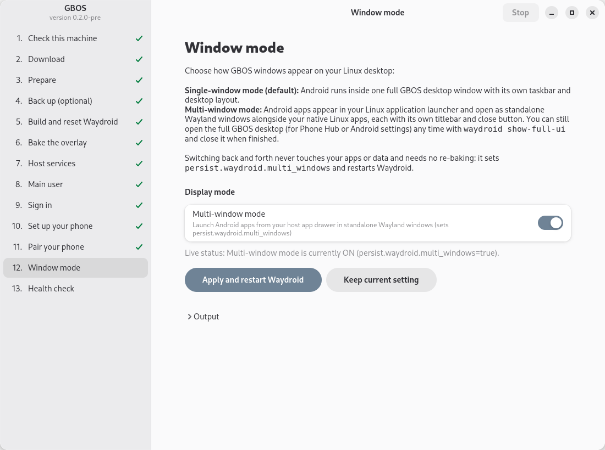
</picture>

### 13. Health check

A read-only check of the whole install. Anything it flags comes with the command that fixes it. Run it whenever
something seems off. **Start GBOS** opens it.

<picture>
  <source media="(prefers-color-scheme: dark)" srcset="assets/screenshots/13-doctor-dark.png">
  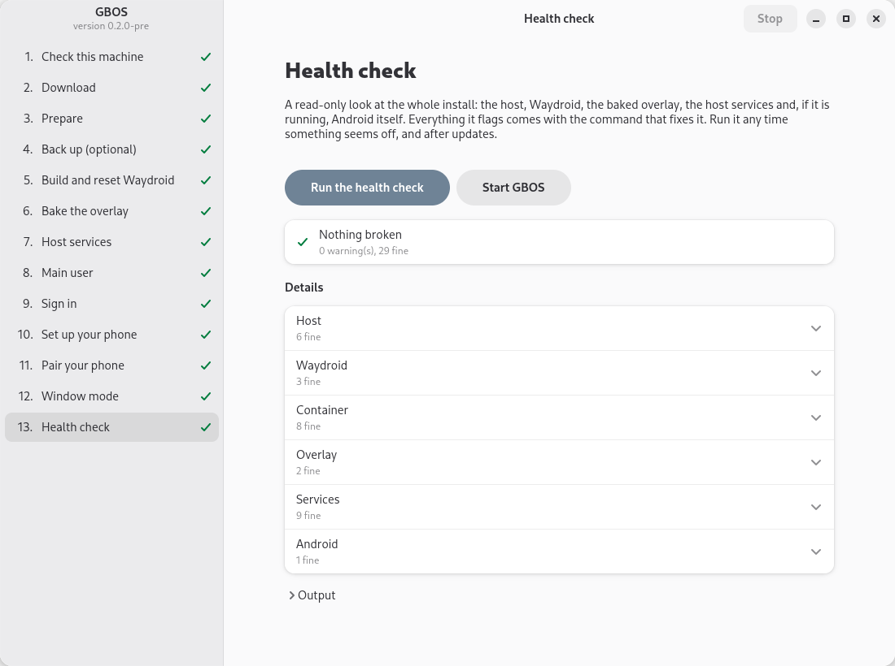
</picture>

The screenshots are the real installer, showing output from a real install on the developer's machine (home folders
renamed).

## Install from the command line

Everything the installer does is a documented command. The same install by hand:

```sh
installer/gbos-install.py check   --downloads ~/gbos/dl --work ~/gbos/work
installer/gbos-install.py fetch   --downloads ~/gbos/dl --with-ndk          # about 10 GB, resumable, sha256-checked
installer/gbos-install.py prepare --downloads ~/gbos/dl --work ~/gbos/work --ndk auto --phone-hub
cd ~/gbos/work && sudo ./try.sh                                              # DESTRUCTIVE, read INSTALL first
```

Then the rest of [docs/INSTALL.md](docs/INSTALL.md): bake the overlay, install the host services, set up adb, pair a phone.

## What works

All of this was verified on the developer's machine (see [HARDWARE](docs/HARDWARE.md)). A second, older and unsupported
machine (a Pixel Slate with an 8th-gen CPU) has reached the desktop with working touch, with no kernel rebuild; see
[UNSUPPORTED-HARDWARE](docs/UNSUPPORTED-HARDWARE.md). Everything else in the table is verified on the first machine only.

| Area | State |
|---|---|
| Boot to the Googlebook desktop (fullscreen or Waydroid multi-window); keyboard, mouse, touch | works |
| Google account sign-in, Play Store installs and updates | works (with the upstream WebView the installer fetches) |
| Sound out; real Bluetooth (the host adapter is shared; Quick Share works) | works |
| USB host support | present; actual device passthrough is untested |
| Hiding the host panel for true fullscreen (used to crash Android) | fix is in the recipe; no verification is recorded |
| Android sees Wi-Fi (virtual radio named after your real network) and sits on your LAN | works |
| Linux Terminal (Debian VM through Android's virtualization framework) | VM boots, networking works |
| Phone Hub: link to a Pixel, notification sync, Do Not Disturb sync, Task Continuity ("Continue On"), Quick Access to phone files | works |
| GNOME Shell Phone Hub extension & GBOS desktop widget (`com.gbos.hub`) | works (top-bar status indicator, searchable phone app launcher, standalone App Cast launch) |
| Phone Hub **app streaming** (App Cast): portrait `720×1600` phone stream in a Wayland window, smooth touch/scroll & physical keyboard forwarding, auto-switching PC/phone audio, no status-bar red pill | works through `ShellCast` (`gb-touch.jar`), `host_relay`, and `feed_live` |
| First-run setup wizard | only its sign-in step runs (the "Finish Googlebook setup" notification); the rest is disabled on purpose, it needs a Google security-chip service that does not exist here |

Why app streaming takes our own route: the official stream is refused because the phone verifies a hardware
attestation GBOS cannot provide. Instead the phone-side companion stack pushes H.264 video and internal audio
(while an App Cast window is open) to relays on your PC, which feed GBOS's own streaming window. See
[ARCHITECTURE](docs/ARCHITECTURE.md).

## Not finished

* **A clean install has been run end to end up to pairing the phone** (on the developer's machine, with its old
  Android data set aside): `check` → `prepare` → `try.sh` → `bake-apps.sh` → host services → main user → Google sign-in
  → `gb-userfixes.sh`, ending with `gbos-doctor.py` at 0 broken. **Pairing a phone and the latest multi-window / GNOME /
  ShellCast / Task Continuity updates have not yet been re-tested from a fresh clean install** (they work on the
  developer's running install). The optional GPU mode was not part of that run.
* **The graphical installer is new.** Its read-only pages are tested, and every root step runs the same scripts as the
  command line, but no one has clicked through a whole clean install with it yet. If a step fails, its Output pane shows
  the command, so you can run it in a terminal.
* **The phone setup step (`gb-phone-setup.sh`)** installs GBOS Cast, grants permissions, enables notification access,
  and reads every change back.
* Only tested on one machine (a 13th-gen Intel laptop with an NVIDIA hybrid GPU). Reports from other hardware are welcome.

The prebuilt Android binaries (`input-bridge`, `vpd-stub`, `libgb-sf-waydroid.so`, `libgb-hwc-waydroid.so`, and the
optional GPU shim) are attached to each
[release](https://github.com/thewraith420/gbos-waydroid/releases) and checked against [`prebuilt.sha256`](prebuilt.sha256)
on download. If you'd rather not trust them, build them yourself with the Android NDK, which the installer can fetch for you.
The build is reproducible, so your build should match the published checksums.

## Read before installing

* **A working Waydroid is a prerequisite.** GBOS replaces the Android *image* inside Waydroid; it does **not** install
  or patch Waydroid's binder layer. If Waydroid doesn't already run on your machine, get it working first — on a distro
  whose stock kernel ships no binderfs (e.g. Debian) that usually means the binder DKMS module a normal Waydroid setup
  adds. `gbos-install.py check` flags it if binder/binderfs isn't there.
* **It needs a recent CPU.** The image uses GFNI, VAES, VPCLMULQDQ, AVX-VNNI and SHA-NI in its first boot processes. It has been
  run on an Intel 13th-gen laptop; an Intel 8th-gen chip (a Pixel Slate) failed immediately. `gbos-install.py check` tells you before
  you download anything. See [HARDWARE](docs/HARDWARE.md).
* **`try.sh` resets Waydroid** (`waydroid init -f`): it deletes Waydroid's data, i.e. any accounts and apps already in
  it. It asks you to type `reset` first, and `installer/gbos-backup.py` can save and restore everything it would delete.
  Updates afterwards use `bake-apps.sh`, which never touches your data.
* The Android side is a **userdebug build with root `adb`**. Authentication is on, and the LAN-facing network
  interface drops the adb port, but treat the container as a development environment.
* The Phone Hub part **edits Play services' local databases** to switch on features Google has not rolled out to this
  device. It changes nothing on Google's servers, but it is not something Google supports.
* Scratch space: allow about **25 GB** free. Do not point the installer at a RAM-backed directory such as `/tmp` on
  systems where that is tmpfs; `check` warns about it.

## Bring your own image

This repository contains **no Google, Lenovo, Lineage or Chromium binaries.** The installer downloads each input
from its original publisher, checks its sha256 against [`sources.lock`](sources.lock), and then patches **your own
copies** with small scripts that assert the exact bytes they expect and stop on any mismatch. You are responsible for
complying with the license terms of what you download. The code here is [MIT](LICENSE), except the kernel modules in
[`kernel/`](kernel/README.md) (`vexemu/`, `secctx/`) and the patch in `kernel/patches/`, which are GPL-2.0 because they link
against GPL-only kernel symbols; the CPU-emulation arithmetic is not in this repository at all (it is fetched at build time
from a pinned upstream patch and checked by sha256).

## Layout

| Path | What it is |
|---|---|
| [`installer/`](installer) | **`gbos-installer-gui.py`** (the graphical installer), `gbos-install.py` (check / fetch / prepare), `extract_recovery.py` (reads the recovery image), `derive_patched.py` (builds the nine patched libraries from your image), **`gbos-backup.py`** (back up / restore Waydroid and its data), **`gbos-doctor.py`** (read-only health check) |
| [`recipe/`](recipe) | the scripts that build and install the system: `try.sh`, `bake-apps.sh`, the patch scripts, the in-container services. [`PATCHES.md`](recipe/PATCHES.md) says what every binary patch is and where its input comes from |
| [`native/`](native) | C sources built into the container (input bridge, signin helper, stubs) |
| [`android/`](android) | sources of the small Android apps (build and signing are done by the installer) |
| [`host/`](host) | services on the PC: LAN, virtual Wi-Fi, Bluetooth bridge, and the Phone Hub / App Cast stack. [README](host/README.md) |
| [`gpu/`](gpu) | **optional** Intel + NVIDIA hybrid-GPU mode. Most machines should skip it. [README](gpu/README.md) |
| [`docs/`](docs) | [INSTALL](docs/INSTALL.md), [ARCHITECTURE](docs/ARCHITECTURE.md), [HARDWARE](docs/HARDWARE.md), [TROUBLESHOOTING](docs/TROUBLESHOOTING.md), [FIRST-TRIAL](docs/FIRST-TRIAL.md) (a checklist for trying it on a machine that already runs Waydroid), [FIX-CATALOG](docs/FIX-CATALOG.md) (why each fix exists), [adb tutorial](docs/TUTORIAL-adb.md), [RELEASING](docs/RELEASING.md) |
| [`assets/screenshots/`](assets/screenshots) | the README screenshots (rendered from the real installer, dark and light) |
| [`tools/scrub.sh`](tools/scrub.sh) | run before any commit: fails if the tree contains keys, tokens, personal paths or third-party binaries |
